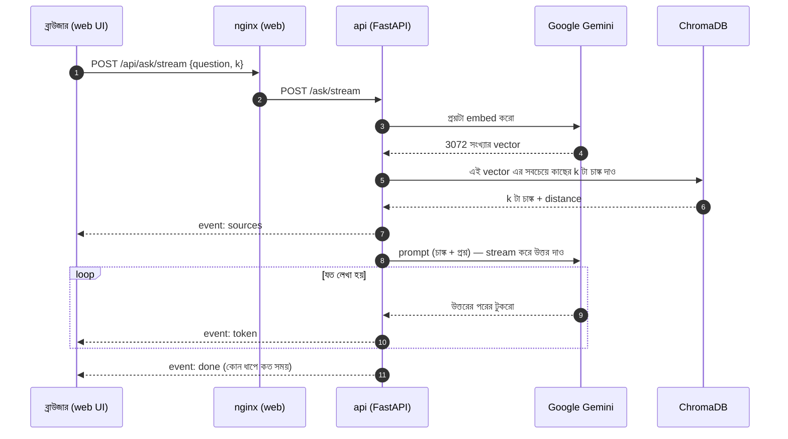

# 🔌 RAG Learning — API Documentation

এই ডকুমেন্টে backend API এর **প্রতিটা endpoint** কী করে, ভেতরে কীভাবে কাজ করে, কী পাঠাতে হয়, কী ফেরত আসে,
কোন ভুলে কোন error আসে — সব আছে। সাথে আছে **নিজে চালিয়ে দেখার কমান্ড** আর একটা **টেস্ট চেকলিস্ট**।

এখানের সব উদাহরণ-উত্তর আসল API থেকে নেওয়া (লম্বা টেক্সট `...` দিয়ে ছোট করা)। তুমি চালালে similarity
বা সময়ের সংখ্যা একটু আলাদা হতে পারে, কিন্তু গঠন একই হবে।

> পুরো সিস্টেম কীভাবে চালাতে হয় সেটা [README.md](README.md) তে। এই ফাইল শুধু API নিয়ে।

---

## সূচিপত্র

0. [শুরুর আগে](#০-শুরুর-আগে)
1. [API এক নজরে](#১-api-এক-নজরে)
2. [সব endpoint এর সাধারণ নিয়ম](#২-সব-endpoint-এর-সাধারণ-নিয়ম)
3. Endpoint গুলো বিস্তারিত
   - [GET /health](#get-health)
   - [GET /stats](#get-stats)
   - [GET /documents](#get-documents)
   - [POST /upload](#post-upload)
   - [POST /ingest](#post-ingest)
   - [POST /search](#post-search)
   - [POST /ask](#post-ask)
   - [POST /ask/stream](#post-askstream)
4. [নিরাপদে টেস্ট করার জন্য Sandbox](#৪-নিরাপদে-টেস্ট-করার-জন্য-sandbox)
5. [টেস্ট চেকলিস্ট](#৫-টেস্ট-চেকলিস্ট)
6. [Python দিয়ে API কল](#৬-python-দিয়ে-api-কল)
7. [সমস্যা ও সমাধান](#৭-সমস্যা-ও-সমাধান)

---

## ০. শুরুর আগে

### সিস্টেম চালু আছে তো?

```powershell
docker compose up -d
docker compose ps        # api, chromadb, web, streamlit — সব Up (healthy)
```

### API কোন ঠিকানায়?

একই API তিনটা ঠিকানা থেকে পাওয়া যায় — কে ডাকছে তার উপর নির্ভর করে:

| কে ডাকছে | ঠিকানা | কেন |
| --- | --- | --- |
| তুমি (PowerShell, curl, Swagger) | `http://localhost:8000` | `api` container এর পোর্ট সরাসরি হোস্টে খোলা (`"8000:8000"`) |
| Web chat UI (ব্রাউজার) | `http://localhost:3000/api` | nginx `/api/...` কে `api:8000/...` তে পাঠায় ([nginx.conf](frontend/nginx.conf)) |
| Streamlit (অন্য container) | `http://api:8000` | Docker network এর ভেতরে service নাম দিয়ে ডাকা |

তিনটাই **একই কোড**, একই উত্তর দেবে। যেমন এই তিনটা একই জিনিস:

```
http://localhost:8000/health
http://localhost:3000/api/health
http://api:8000/health          ← শুধু container এর ভেতর থেকে
```

### API টেস্ট করার ৩টা উপায়

**১. Swagger UI (সবচেয়ে সহজ, বাংলাও ঠিকঠাক চলে)** — ব্রাউজারে খোলো **http://localhost:8000/docs**।
যেকোনো endpoint এ ক্লিক → **Try it out** → body লেখো → **Execute**। নিচে আসল request (curl), status code আর উত্তর দেখাবে।
FastAPI এটা কোড থেকে নিজে বানায় — কোনো আলাদা কাজ করতে হয়নি। (ব্যতিক্রম: `/upload` এ ফাইল বাছাই Swagger এ কাজ করে না — নিচে দেখো।)
একই জিনিস অন্য ডিজাইনে: http://localhost:8000/redoc, আর মেশিনের পড়ার মতো সংজ্ঞা: http://localhost:8000/openapi.json

**২. PowerShell** — প্রথমে এই দুইটা জিনিস একবার চালিয়ে নাও (টার্মিনাল বন্ধ না করা পর্যন্ত থাকবে):

```powershell
$B = "http://localhost:8000"     # sandbox এ টেস্ট করলে: "http://localhost:8010" (৪ নম্বর সেকশন দেখো)

# POST + JSON পাঠানোর ছোট helper
function Invoke-Rag($Path, $Body) {
    # Windows PowerShell 5.1 নিজে থেকে বাংলা ঠিকমতো পাঠায় না — তাই JSON কে UTF-8 bytes বানিয়ে পাঠাই
    $bytes = [System.Text.Encoding]::UTF8.GetBytes(($Body | ConvertTo-Json))
    Invoke-RestMethod -Method Post -Uri "$B$Path" -ContentType "application/json; charset=utf-8" -Body $bytes
}
```

> **কেন helper লাগলো?** সাধারণভাবে `-Body ($body | ConvertTo-Json)` দিলে PowerShell 5.1 বাংলা অক্ষরগুলোকে `?????`
> বানিয়ে পাঠায়। টেস্টে দেখা গেছে LLM তখন উত্তর দেয়: *"the question appears with unreadable characters"*!
> ইংরেজি প্রশ্নে সমস্যা নেই। PowerShell 7 (`pwsh`) এ এই ঝামেলা নেই।

PowerShell এ error এর বিস্তারিত দেখতে:

```powershell
try { Invoke-Rag "/ask" @{ question = "" } } catch { $_.Exception.Response.StatusCode.value__; $_.ErrorDetails.Message }
```

**৩. curl** — Git Bash এ `curl`, PowerShell এ অবশ্যই **`curl.exe`** লিখবে (PowerShell 5.1 এ শুধু `curl` লিখলে
সেটা আসলে `Invoke-WebRequest` চালায়)। ফাইল আপলোড আর streaming এর জন্য curl সবচেয়ে সহজ।

```bash
B=http://localhost:8000          # Git Bash
curl $B/health
```

---

## ১. API এক নজরে

| Method | Endpoint | কাজ | Gemini কল | কিছু বদলায়? |
| --- | --- | --- | --- | --- |
| GET | [`/health`](#get-health) | API আর ChromaDB চলছে কিনা | না | না |
| GET | [`/stats`](#get-stats) | কয়টা চাঙ্ক, কোন ফাইল, কোন মডেল, কোন সেটিং | না | না |
| GET | [`/documents`](#get-documents) | `docs/` ফোল্ডারে কোন ফাইল আছে | না | না |
| POST | [`/upload`](#post-upload) | ফাইল `docs/` এ সেভ | না | **হ্যাঁ** — `docs/` ফোল্ডার |
| POST | [`/ingest`](#post-ingest) | `docs/` থেকে পুরো Vector DB নতুন করে বানাও | প্রতি ৫০ চাঙ্কে ১টা embedding কল | **হ্যাঁ** — পুরো index বদলায় |
| POST | [`/search`](#post-search) | শুধু retrieval — প্রশ্নের সাথে মেলে এমন চাঙ্ক | ১টা embedding | না |
| POST | [`/ask`](#post-ask) | পুরো RAG — উত্তর একবারে | ১টা embedding + ১টা LLM | না |
| POST | [`/ask/stream`](#post-askstream) | পুরো RAG — উত্তর টুকরো টুকরো (streaming) | ১টা embedding + ১টা LLM | না |

সব endpoint এর কোড একটা ফাইলেই: [backend/app/main.py](backend/app/main.py)। আসল RAG লজিক
[rag.py](backend/app/rag.py) (retrieval + generation) আর [ingest.py](backend/app/ingest.py) (ingestion) তে।
`main.py` শুধু HTTP রিকোয়েস্ট নিয়ে ঐ ফাংশনগুলো ডাকে।

### একটা প্রশ্নের পুরো যাত্রা (web UI থেকে)



---

## ২. সব endpoint এর সাধারণ নিয়ম

### Request আর Response

- POST endpoint গুলো **JSON** নেয় (`Content-Type: application/json`) — শুধু `/upload` নেয় **multipart/form-data** (ফাইল)।
- সব উত্তর **JSON**, encoding **UTF-8**। Header এ `application/json; charset=utf-8` থাকে।
  `/ask/stream` এর উত্তর `text/event-stream`।

### Input যাচাই (Validation) — 422

`/search`, `/ask`, `/ask/stream` এর body একটা Pydantic model দিয়ে সংজ্ঞায়িত
([`QuestionRequest`](backend/app/main.py#L38)):

```python
class QuestionRequest(BaseModel):
    question: str = Field(..., min_length=1)        # অবশ্যই দিতে হবে, খালি হবে না
    k: int = Field(config.TOP_K, ge=1, le=20)      # না দিলে 4; 1 থেকে 20 এর মধ্যে
```

| Field | Type | দিতে হবে? | ডিফল্ট | নিয়ম |
| --- | --- | --- | --- | --- |
| `question` | string | **হ্যাঁ** | — | কমপক্ষে ১ অক্ষর |
| `k` | integer | না | `4` (`.env` এর `TOP_K`) | 1 ≤ k ≤ 20 — কয়টা চাঙ্ক retrieve হবে |

নিয়ম না মানলে FastAPI তোমার কোড চালানোর **আগেই** `422 Unprocessable Entity` দেয়, সাথে ঠিক কোন field এ
কী ভুল সেটা বলে দেয়:

```json
// {"question": ""} পাঠালে
{
  "detail": [
    {
      "type": "string_too_short",
      "loc": ["body", "question"],
      "msg": "String should have at least 1 character",
      "input": "",
      "ctx": { "min_length": 1 }
    }
  ]
}
```

`loc` পড়ো এভাবে: body → question field এ সমস্যা। `{"question": "hi", "k": 50}` দিলে আসবে
`"loc": ["body", "k"]`, `"msg": "Input should be less than or equal to 20"`। আর body একদম না দিলে
`"loc": ["body"]`, `"msg": "Field required"`।

### Status code গুলো

| Code | মানে | এই API তে কখন আসে |
| --- | --- | --- |
| **200** OK | সফল | সব ঠিক থাকলে |
| **400** Bad Request | তোমার রিকোয়েস্টের জিনিসটাই সমস্যা | অসমর্থিত ফাইল টাইপ আপলোড; `docs/` খালি বা ফাইলে টেক্সট নেই |
| **404** Not Found | এই URL নেই | ভুল path, যেমন `/asks` |
| **405** Method Not Allowed | URL আছে কিন্তু ভুল method | যেমন `GET /ask` (হওয়া উচিত `POST`) |
| **409** Conflict | এখন করা যাবে না | একটা `/ingest` চলাকালীন আরেকটা `/ingest` |
| **422** Unprocessable Entity | body এর গঠন/মান ভুল | উপরে দেখো |
| **502** Bad Gateway | আমাদের সার্ভার ঠিক আছে, কিন্তু যার উপর নির্ভর করে (Gemini/ChromaDB) সে ব্যর্থ | ভুল মডেল নাম, API key সমস্যা, rate limit, ChromaDB বন্ধ |
| **500** Internal Server Error | কোডে অপ্রত্যাশিত bug | হওয়ার কথা না — হলে `docker compose logs api` দেখো |

### Error এর গঠন

```json
{ "detail": "এখানে মানুষের পড়ার মতো কারণ" }
```

ব্যতিক্রম: 422 তে `detail` একটা **লিস্ট** (উপরে দেখো)। আর 502 তে `detail` এর শুরুতে আসল error এর ধরন থাকে,
যেমন `"GoogleModelNotFoundError: ..."` বা `"ValueError: Could not connect to a Chroma server..."` —
কোডে [`upstream_error()`](backend/app/main.py#L43) এটা বানায়।

### সময়সীমা (timeout)

- Gemini LLM কল: সর্বোচ্চ 120 সেকেন্ড ([`get_llm()`](backend/app/rag.py#L88))।
- nginx দিয়ে আসলে (`localhost:3000/api`): সর্বোচ্চ 1800 সেকেন্ড — বড় ingestion এর জন্য।

### ⚠️ নিরাপত্তা — এটা শেখার প্রজেক্ট

- **কোনো login/authentication নেই।** যে API তে পৌঁছাতে পারবে সে ফাইল আপলোড, ingest (তোমার Gemini quota খরচ) সব করতে পারবে।
- `docker-compose.yml` এ পোর্টগুলো `"8000:8000"` আকারে খোলা — এর মানে তোমার **একই Wi-Fi এর অন্য ডিভাইস থেকেও**
  `http://তোমার-IP:8000` দিয়ে ঢোকা যায় (ChromaDB `8001` সহ)। শুধু নিজের পিসি থেকে চাইলে আগে `127.0.0.1:` বসাও:
  `"127.0.0.1:8000:8000"`, `"127.0.0.1:8001:8000"`, `"127.0.0.1:3000:80"`, `"127.0.0.1:8501:8501"`।
- ইন্টারনেটে খুলে দেওয়ার আগে অবশ্যই authentication, rate limit আর HTTPS লাগবে।

---

## ৩. Endpoint গুলো বিস্তারিত

### GET /health

**কাজ:** API নিজে চলছে কিনা, আর ChromaDB তে পৌঁছানো যাচ্ছে কিনা।

**কারা ব্যবহার করে:**
- Docker — `api` এর `healthcheck` প্রতি 10 সেকেন্ডে এটা ডাকে ([docker-compose.yml](docker-compose.yml)); উত্তর না পেলে container কে *unhealthy* ধরে।
- Web UI — উপরের ডান কোণার **Connected** লেখাটা প্রতি 15 সেকেন্ডে এটা দেখে বসায়।

**Request:** কিছু লাগে না।

**Response:**

| Field | মান |
| --- | --- |
| `api` | সবসময় `"ok"` (উত্তর আসছে মানেই API চলছে) |
| `chromadb` | `"ok"`, অথবা `"error: <কারণ>"` |

```json
{ "api": "ok", "chromadb": "ok" }
```

ChromaDB বন্ধ থাকলে (status **তবুও 200**):

```json
{ "api": "ok", "chromadb": "error: Could not connect to a Chroma server. Are you sure it is running?" }
```

**ভেতরে কী হয়** ([main.py#L51](backend/app/main.py#L51)): `get_chroma_client().heartbeat()` — ChromaDB সার্ভারকে
"বেঁচে আছো?" জিজ্ঞেস করে। Exception হলে সেটার মেসেজ `chromadb` field এ বসায়।

> **ডিজাইন নিয়ে ভাবো:** ChromaDB বন্ধ থাকলেও কেন 200? কারণ Docker এর healthcheck শুধু "API প্রসেস বেঁচে আছে কিনা"
> জানতে চায় — ChromaDB বন্ধ বলে API container রিস্টার্ট করে লাভ নেই। আসল প্রোডাকশনে প্রায়ই দুইটা আলাদা endpoint
> থাকে: `/health/live` (প্রসেস চলছে?) আর `/health/ready` (সব dependency রেডি? না হলে 503)।

**চালিয়ে দেখো:**

```powershell
Invoke-RestMethod "$B/health"
```
```bash
curl $B/health
```

**✅ চেক করো:**
- [ ] `{"api":"ok","chromadb":"ok"}` আসছে।
- [ ] `docker compose stop chromadb` দিয়ে আবার ডাকো → `chromadb` এ error আসবে, কিন্তু status 200। Web UI এর উপরের ডান কোণায় কমলা রঙে **ChromaDB সমস্যা**।
  তারপর `docker compose start chromadb` — কয়েক সেকেন্ডে আবার `ok`।

---

### GET /stats

**কাজ:** সিস্টেমের এখনকার অবস্থা এক জায়গায় — web UI এর sidebar এর সংখ্যা আর মডেলের নাম এখান থেকেই আসে।

**Request:** কিছু লাগে না।

**Response:**

| Field | মানে | কোথা থেকে আসে |
| --- | --- | --- |
| `collection` | ChromaDB তে কোন collection (টেবিলের মতো) ব্যবহার হচ্ছে | `.env` এর `COLLECTION_NAME` (ডিফল্ট `rag_docs`) |
| `chunks` | Vector DB তে এখন কয়টা চাঙ্ক আছে | ChromaDB থেকে গুনে ([`count_chunks()`](backend/app/vectorstore.py#L39)) |
| `files` | `docs/` ফোল্ডারে কোন ফাইলগুলো আছে | [`/documents`](#get-documents) এর মতোই |
| `chat_model` | উত্তর লেখার LLM | `.env` এর `CHAT_MODEL` |
| `embedding_model` | টেক্সট → vector মডেল | `.env` এর `EMBEDDING_MODEL` |
| `chunk_size`, `chunk_overlap` | চাঙ্কিং সেটিং | `.env` এর `CHUNK_SIZE`, `CHUNK_OVERLAP` |

```json
{
  "collection": "rag_docs",
  "chunks": 8,
  "files": ["nexora_cloudbox_faq.txt", "nexora_employee_handbook.md", "office_rules_bn.txt"],
  "chat_model": "gemini-3.5-flash-lite",
  "embedding_model": "models/gemini-embedding-001",
  "chunk_size": 1000,
  "chunk_overlap": 200
}
```

**Error:** ChromaDB বন্ধ থাকলে `502` — `{"detail": "ValueError: Could not connect to a Chroma server. ..."}`।
Collection এখনো না থাকলে (কখনো ingest হয়নি) error না, `chunks: 0`।

> **গুরুত্বপূর্ণ পার্থক্য:** `files` = ফোল্ডারে **এখন** কী আছে। `chunks` = **শেষবার ingest** এর সময় কী ঢুকেছিল।
> নতুন ফাইল আপলোড করে ingest না করলে `files` বাড়বে, কিন্তু `chunks` বদলাবে না — আর সেই ফাইল থেকে প্রশ্নের উত্তরও আসবে না।

**চালিয়ে দেখো:**

```powershell
Invoke-RestMethod "$B/stats"
```

**✅ চেক করো:**
- [ ] `chat_model` আর `embedding_model` তোমার `.env` এর সাথে মিলছে।
- [ ] `.env` এ `CHUNK_SIZE=300` দিয়ে `docker compose up -d` → `chunk_size` এখন 300 (কিন্তু `chunks` বদলাবে ingest এর পরেই)। পরে আবার মুছে দিও।

---

### GET /documents

**কাজ:** `docs/` ফোল্ডারে (container এর ভেতরে `/app/docs`) কোন কোন সমর্থিত ফাইল আছে তার লিস্ট।

**Request:** কিছু লাগে না। **Response:** string এর লিস্ট (ফাইলের path, `docs/` থেকে relative, বর্ণানুক্রমে)।

```json
["nexora_cloudbox_faq.txt", "nexora_employee_handbook.md", "office_rules_bn.txt"]
```

**ভেতরে কী হয়** ([main.py#L79](backend/app/main.py#L79)): `os.walk()` দিয়ে ফোল্ডার আর **সাব-ফোল্ডার** ঘুরে শুধু
`.pdf`, `.txt`, `.md`, `.docx` ফাইলগুলো নেয়। সাব-ফোল্ডারে থাকলে নাম আসবে `subfolder/file.pdf` আকারে।

> `docs/` হলো তোমার পিসির `docs/` ফোল্ডারের **bind mount** — পিসিতে File Explorer দিয়ে ফাইল রাখলেও সাথে সাথে এখানে দেখাবে।

**✅ চেক করো:**
- [ ] File Explorer দিয়ে `docs/` এ একটা `.txt` ফাইল রাখো → আবার ডাকো → নতুন ফাইলটা লিস্টে আছে।
- [ ] একটা `.png` রাখো → লিস্টে **আসবে না** (সমর্থিত না)।

---

### POST /upload

**কাজ:** এক বা একাধিক ফাইল `docs/` ফোল্ডারে সেভ করে। **Ingest করে না** — এরপর আলাদাভাবে [`/ingest`](#post-ingest) ডাকতে হবে।

**Request:** `multipart/form-data`, প্রতিটা ফাইল **`files`** নামের field এ (একই নামে একাধিকবার দিলে একাধিক ফাইল)।

**Response:**

```json
{ "saved": ["test.pdf", "test.docx"] }
```

**ভেতরে কী হয়** ([main.py#L90](backend/app/main.py#L90)):

1. প্রতিটা ফাইলের নাম থেকে শুধু শেষ অংশ নেয় (`os.path.basename`)। তাই কেউ `../../evil.docx` নাম দিলেও
   ফাইলটা `docs/evil.docx` হিসেবেই সেভ হবে, `docs/` এর বাইরে যেতে পারবে না (একে বলে **path traversal** আটকানো)।
2. **আগে সব ফাইলের** extension চেক করে। একটাও অসমর্থিত হলে কোনো ফাইলই সেভ হয় না (অর্ধেক সেভ হয়ে থাকে না)।
3. তারপর সবগুলো `docs/` এ লেখে। একই নামের ফাইল থাকলে **কিছু না জিজ্ঞেস করেই overwrite** করে।

**Error:**

| Status | কখন | উদাহরণ |
| --- | --- | --- |
| 400 | অন্তত একটা ফাইলের extension সমর্থিত না | `{"detail": "সাপোর্টেড না: ['bad.exe']। শুধু: ['.docx', '.md', '.pdf', '.txt']"}` |
| 422 | কোনো ফাইলই পাঠানো হয়নি | `"loc": ["body", "files"], "msg": "Field required"` |

> **সীমা:** শুধু extension দেখে, ভেতরের content না — `.pdf` নাম দিয়ে আসলে ছবি পাঠালেও সেভ হবে (পরে ingest এ টেক্সট পাবে না)।
> nginx দিয়ে (`localhost:3000/api/upload`) এলে প্রতি রিকোয়েস্ট সর্বোচ্চ 200MB ([nginx.conf](frontend/nginx.conf))।

**চালিয়ে দেখো** (PowerShell 5.1 এ ফাইল পাঠানো সবচেয়ে সহজ `curl.exe` দিয়ে):

```powershell
curl.exe -X POST "$B/upload" -F "files=@C:\path\to\my.pdf"
curl.exe -X POST "$B/upload" -F "files=@a.pdf" -F "files=@b.docx"      # একসাথে একাধিক
```
```bash
curl -X POST $B/upload -F "files=@my.pdf"
```

> **Swagger এ কেন হয় না?** Swagger এ `/upload` খুললে ফাইল বাছাইয়ের বাটনের বদলে একটা আজব টেক্সট বক্স আসে। নতুন FastAPI
> OpenAPI 3.1 এ ফাইলকে `contentMediaType` দিয়ে বর্ণনা করে, আর Swagger UI সেটা এখনো ফাইল বাছাই হিসেবে দেখায় না।
> তাই ফাইল আপলোড টেস্ট করো `curl.exe` বা web UI (http://localhost:3000) দিয়ে।

**✅ চেক করো:**
- [ ] একটা PDF আপলোড → `saved` এ নাম আছে → [`/documents`](#get-documents) এ আছে → [`/stats`](#get-stats) এ `chunks` **বদলায়নি**।
- [ ] একটা `.pdf` আর একটা `.exe` একসাথে পাঠাও → 400, আর `docs/` এ PDF টাও **সেভ হয়নি**।

---

### POST /ingest

**কাজ:** `docs/` ফোল্ডারের সব ফাইল থেকে **পুরো Vector DB নতুন করে বানায়** (Ingestion pipeline)।
Web UI এর **Rebuild index** বাটন আর `docker compose run --rm ingest` কমান্ড — দুটোই ঠিক এই একই কাজ করে।

**Request:** কোনো body লাগে না।

**Response:**

| Field | মানে |
| --- | --- |
| `files` | কোন ফাইলগুলো থেকে টেক্সট পাওয়া গেছে |
| `documents` | মোট "Document" — **PDF এর প্রতিটা পেজ আলাদা** গোনা হয়, txt/md/docx একটা করে |
| `chunks` | মোট কয়টা চাঙ্ক বানিয়ে Vector DB তে রাখা হলো |

```json
{
  "files": ["nexora_cloudbox_faq.txt", "nexora_employee_handbook.md", "office_rules_bn.txt", "test.docx", "test.pdf"],
  "documents": 6,
  "chunks": 11
}
```

এখানে ৫টা ফাইল কিন্তু ৬টা document — কারণ `test.pdf` এর ২টা পেজ।

**ভেতরে কী হয়** ([main.py#L107](backend/app/main.py#L107) → [`run_ingestion()`](backend/app/ingest.py#L146)):

1. **Lock** — অন্য কোনো ingest চলছে কিনা দেখে; চললে সাথে সাথে `409`।
2. **Load** — [`load_documents()`](backend/app/ingest.py#L51): প্রতিটা ফাইল থেকে টেক্সট বের করে (PDF → `pypdf` দিয়ে পেজ ধরে ধরে,
   DOCX → `docx2txt`, TXT/MD → সরাসরি পড়া)। কোনো ফাইল না থাকলে → `400`।
3. **Chunk** — [`split_documents()`](backend/app/ingest.py#L81): ~1000 ক্যারেক্টারের টুকরো, 200 overlap। প্রতিটা চাঙ্কে নম্বর (`chunk_id`) বসে।
   কোনো টেক্সটই না পেলে (যেমন শুধু স্ক্যান করা PDF) → `400`।
4. **পুরনো index মোছা** — [`store_chunks()`](backend/app/ingest.py#L105) collection টা পুরো মুছে ফেলে।
5. **Embed + Store** — ৫০টা করে চাঙ্ক Gemini তে পাঠিয়ে vector আনে, তারপর টেক্সট + vector + metadata ChromaDB তে রাখে।
   Rate limit (429) বা Gemini ব্যস্ত (503) হলে 15, 30, 45... সেকেন্ড অপেক্ষা করে সর্বোচ্চ ৫ বার চেষ্টা করে ([`_add_with_retry()`](backend/app/ingest.py#L127))।
6. Lock ছেড়ে দিয়ে ফলাফল ফেরত দেয়।

**Error:**

| Status | কখন | উদাহরণ |
| --- | --- | --- |
| 400 | `docs/` এ কোনো সমর্থিত ফাইল নেই | `{"detail": "'/app/docs' ফোল্ডারে কোনো সাপোর্টেড ফাইল নেই (.docx, .md, .pdf, .txt)।"}` |
| 400 | ফাইল আছে কিন্তু কোনো টেক্সট নেই | `{"detail": "ফাইলগুলো থেকে কোনো টেক্সট পাওয়া যায়নি (স্ক্যান করা PDF হলে টেক্সট থাকে না)।"}` |
| 409 | আরেকটা ingest চলছে | `{"detail": "আরেকটা ingestion এখন চলছে, একটু পরে চেষ্টা করো।"}` |
| 502 | Gemini বা ChromaDB ব্যর্থ (৫ বার চেষ্টার পরেও) | `{"detail": "ClientError: 429 RESOURCE_EXHAUSTED ..."}` |

> **index কখন নিরাপদ, কখন না — মন দিয়ে পড়ো:**
> - ধাপ ২-৩ এ ব্যর্থ হলে (`400`) পুরনো index **অক্ষত থাকে** — কারণ মোছা হয় ধাপ ৪ এ। (টেস্টে দেখা গেছে: খালি ফোল্ডারে ingest → 400, কিন্তু আগের 11টা চাঙ্ক রয়ে গেছে।)
> - কিন্তু ধাপ ৫ এর মাঝখানে ব্যর্থ হলে (`502`) পুরনোটা মোছা হয়ে গেছে আর নতুনটা **অর্ধেক** — আবার ingest করতে হবে।
>   বড় সিস্টেমে এটা এড়াতে নতুন collection এ বানিয়ে শেষে নাম বদলানো হয় ("blue-green" কৌশল)।

**খরচ আর সময়:** প্রতি ৫০ চাঙ্কে একটা Gemini embedding কল। ৩টা sample ফাইল (৮ চাঙ্ক) এ ~1.5 সেকেন্ড; বড় PDF এ মিনিটও লাগতে পারে।

**চালিয়ে দেখো:**

```powershell
Invoke-RestMethod -Method Post "$B/ingest"
```
```bash
curl -X POST $B/ingest
```

**✅ চেক করো:**
- [ ] উত্তরের `chunks` আর এরপর [`/stats`](#get-stats) এর `chunks` একই।
- [ ] একটা ২ পেজের PDF রাখলে `documents` ফাইল সংখ্যার চেয়ে বেশি হয়।
- [ ] দুইবার পরপর ingest করো → `chunks` দ্বিগুণ **হয় না** (প্রতিবার মুছে নতুন বানায়)।
- [ ] **409 দেখো** — একটা ingest পেছনে চালিয়ে সাথে সাথে আরেকটা:
  ```powershell
  Start-Process curl.exe -ArgumentList "-s -o NUL -X POST $B/ingest" -NoNewWindow
  Start-Sleep -Milliseconds 300
  try { Invoke-RestMethod -Method Post "$B/ingest" } catch { $_.ErrorDetails.Message }
  ```

---

### POST /search

**কাজ:** **শুধু Retrieval** — প্রশ্নের অর্থের সাথে সবচেয়ে বেশি মেলে এমন `k` টা চাঙ্ক দেখায়। **LLM কল হয় না।**
Web UI এর **শুধু Search** মোড এটাই ডাকে।

RAG এর উত্তর খারাপ হলে প্রথমে এটা দিয়ে দেখো: সঠিক চাঙ্ক আসছে তো? না আসলে সমস্যা retrieval এ
(chunking/embedding/ডকুমেন্ট), LLM এ না।

**Request:**

```json
{ "question": "How many days can I work from home?", "k": 2 }
```

**Response:**

```json
{
  "question": "How many days can I work from home?",
  "results": [
    {
      "source": "nexora_employee_handbook.md",
      "page": null,
      "chunk_id": 3,
      "similarity": 0.6711,
      "content": "Employees on probation must work from the office every day.\n\n## 3. Leave Policy ..."
    },
    {
      "source": "nexora_employee_handbook.md",
      "page": null,
      "chunk_id": 2,
      "similarity": 0.6621,
      "content": "# Nexora Tech — Employee Handbook (Sample)\n\n> This is a fictional ..."
    }
  ]
}
```

| Field | মানে |
| --- | --- |
| `source` | কোন ফাইল থেকে (`docs/` থেকে relative path) |
| `page` | PDF হলে পেজ নম্বর (**1 থেকে** গোনা); অন্য ফাইলে `null` |
| `chunk_id` | ingest এর সময় দেওয়া চাঙ্কের নম্বর। **আবার ingest করলে বদলে যেতে পারে** — স্থায়ী ID হিসেবে ব্যবহার করো না। |
| `similarity` | প্রশ্নের সাথে মিল: `1 - cosine distance`। 1 এর যত কাছে, তত বেশি মিল। ফলাফল এটা অনুযায়ী বড় থেকে ছোট সাজানো। |
| `content` | চাঙ্কের পুরো টেক্সট |

**ভেতরে কী হয়** ([main.py#L122](backend/app/main.py#L122) → [`retrieve()`](backend/app/rag.py#L51)):

1. `similarity_search_with_score(question, k)` ডাকে, যেটা:
   - প্রশ্নটাকে Gemini দিয়ে embed করে — **ingestion এর একই মডেল**, তবে `RETRIEVAL_QUERY` মোডে (ডকুমেন্ট embed হয় `RETRIEVAL_DOCUMENT` মোডে; Gemini প্রশ্ন আর উত্তরকে একটু আলাদাভাবে encode করে যাতে ভালো মেলে)।
   - ChromaDB তে ঐ vector এর সবচেয়ে কাছের `k` টা vector খোঁজে (HNSW index — সব vector একটা একটা না দেখে দ্রুত আনুমানিক খোঁজা)।
   - প্রতিটার **cosine distance** দেয় (0 = একদম একই দিক, যত বড় তত দূরে)।
2. distance কে `similarity = 1 - distance` বানায়, metadata থেকে source/page/chunk_id বের করে, PDF পেজ 0-based থেকে 1-based করে।

**বিশেষ অবস্থা:** Vector DB খালি হলে error না, `"results": []`। DB তে `k` এর চেয়ে কম চাঙ্ক থাকলে যতগুলো আছে ততগুলোই আসে।

**Error:** `422` (validation), `502` (Gemini embedding বা ChromaDB ব্যর্থ)।

**চালিয়ে দেখো:**

```powershell
$r = Invoke-Rag "/search" @{ question = "How many days can I work from home?"; k = 3 }
$r.results | Format-Table source, page, chunk_id, similarity
```
```bash
curl -X POST $B/search -H "Content-Type: application/json" \
  -d '{"question": "How many days can I work from home?", "k": 3}'
```

**✅ চেক করো:**
- [ ] `similarity` গুলো বড় থেকে ছোট সাজানো।
- [ ] **হাতে হিসাব মেলাও:** `docker compose exec api python -m app.inspect_db "How many days can I work from home?"` — numpy দিয়ে হিসাব করা সংখ্যাগুলো এখানের `similarity` এর সাথে হুবহু মিলবে।
- [ ] **Cross-lingual:** `Invoke-Rag "/search" @{ question = "বাসা থেকে কত দিন কাজ করা যায়?" }` — ইংরেজি handbook এর চাঙ্ক আসছে?
- [ ] `k = 1` আর `k = 10` তে পার্থক্য দেখো।

---

### POST /ask

**কাজ:** **পুরো RAG** — retrieve করে, চাঙ্কগুলো দিয়ে prompt বানিয়ে, Gemini কে দিয়ে উত্তর লেখায়। উত্তর **একবারে** আসে
(LLM লেখা শেষ না করা পর্যন্ত অপেক্ষা)। টাইপ হতে হতে চাইলে [`/ask/stream`](#post-askstream)।

**Request:** [`/search`](#post-search) এর মতোই।

```json
{ "question": "How much is the learning budget?", "k": 3 }
```

**Response:**

```json
{
  "question": "How much is the learning budget?",
  "answer": "Based on the provided documents, every full-time employee gets a yearly learning budget of 30,000 BDT [1].",
  "sources": [
    { "source": "nexora_employee_handbook.md", "page": null, "chunk_id": 4, "similarity": 0.6426, "content": "Annual leave longer than 5 ..." },
    { "source": "nexora_cloudbox_faq.txt",     "page": null, "chunk_id": 0, "similarity": 0.6381, "content": "CloudBox by Nexora Tech ..." },
    { "source": "nexora_cloudbox_faq.txt",     "page": null, "chunk_id": 1, "similarity": 0.6243, "content": "Q: Where is my data stored? ..." }
  ],
  "prompt": "System: You are a helpful assistant that answers questions using ONLY the provided context.\n- Reply in ..."
}
```

| Field | মানে |
| --- | --- |
| `answer` | LLM এর উত্তর (markdown হতে পারে — `**bold**`, লিস্ট) |
| `sources` | LLM কে যে চাঙ্কগুলো দেওয়া হয়েছিল — গঠন [`/search`](#post-search) এর `results` এর মতো |
| `prompt` | **LLM আসলে যে পুরো prompt পেয়েছিল** — শেখা আর debugging এর জন্য |

**Citation পড়া:** উত্তরের `[1]` মানে `sources[0]`, `[2]` মানে `sources[1]` — অর্থাৎ `[n]` = `sources[n-1]`।
বাংলা উত্তরে মডেল প্রায়ই বাংলা সংখ্যা লেখে: `[১]`। (Web UI দুটোকেই ক্লিক করা যায় এমন বাটন বানায়।)

**ভেতরে কী হয়** ([main.py#L131](backend/app/main.py#L131) → [`answer()`](backend/app/rag.py#L103)):

1. [`retrieve()`](backend/app/rag.py#L51) — ঠিক [`/search`](#post-search) এর মতো।
2. [`build_context()`](backend/app/rag.py#L77) — চাঙ্কগুলোকে নম্বর দিয়ে সাজায়:
   ```
   [1] (nexora_employee_handbook.md)
   ...চাঙ্কের টেক্সট...

   ---

   [2] (test.pdf, page 2)
   ...
   ```
3. [`detect_language()`](backend/app/rag.py#L39) — প্রশ্নে একটাও বাংলা অক্ষর (Unicode U+0980–U+09FF) থাকলে `Bengali`, নাহলে `English`।
4. [`PROMPT`](backend/app/rag.py#L22) এ সব বসানো হয়:
   ```
   System: You are a helpful assistant that answers questions using ONLY the provided context.
   - Reply in the same language as the question ...
   - Cite the sources you used like [1], [2] ...
   - If the context does not contain the answer, just say that you don't know ... Do not cite anything ...
   Human: Context:
   [1] (...) ...
   ---
   [2] (...) ...

   Question: How much is the learning budget?

   Answer in English.
   ```
5. [`generate()`](backend/app/rag.py#L93) — Gemini কে পাঠায় (`llm.invoke()`), উত্তরের টেক্সট নেয়।

**বিশেষ অবস্থা:**

- Vector DB খালি → LLM ডাকেই না (Gemini খরচ বাঁচে), status 200:
  ```json
  { "question": "...", "answer": "Vector DB খালি। আগে ডকুমেন্ট ingest করো।", "sources": [], "prompt": null }
  ```
- ডকুমেন্টে উত্তর নেই → `"answer": "I don't know based on the given documents."` — `sources` তবুও থাকে
  (retriever সবসময় সবচেয়ে কাছের `k` টা দেয়, মিল কম হলেও)। **retriever কখনো "কিছু পাইনি" বলে না; "জানি না" বলাটা LLM এর কাজ।**

**Error:** `422` (validation), `502` (Gemini বা ChromaDB ব্যর্থ)। যেমন ভুল মডেল নাম:

```json
{ "detail": "GoogleModelNotFoundError: Error calling model 'gemini-does-not-exist' (NOT_FOUND): 404 NOT_FOUND. ..." }
```

**চালিয়ে দেখো:**

```powershell
$r = Invoke-Rag "/ask" @{ question = "How much is the learning budget?"; k = 3 }
$r.answer
$r.sources | Format-Table source, page, similarity
$r.prompt              # LLM কী পেয়েছিল

# বাংলা প্রশ্ন (Invoke-Rag helper ছাড়া চলবে না — উপরে দেখো)
(Invoke-Rag "/ask" @{ question = "অফিসে দুপুরের খাবারের জন্য বেতন থেকে কত টাকা কাটা হয়?" }).answer
```
```bash
curl -X POST $B/ask -H "Content-Type: application/json" \
  -d '{"question": "How much is the learning budget?", "k": 3}'
```

**✅ চেক করো:**
- [ ] উত্তরে `[1]` আছে, আর `sources[0].content` এ সত্যিই সেই তথ্য আছে।
- [ ] ইংরেজি প্রশ্ন → ইংরেজি উত্তর; বাংলা প্রশ্ন → বাংলা উত্তর; `prompt` এর শেষ লাইন `Answer in English.` / `Answer in Bengali.`।
- [ ] "Who is the CEO of Nexora Tech?" → "don't know", আর উত্তরে কোনো `[n]` নেই।
- [ ] `k = 1` দিয়ে "Explain the leave policy in detail" — উত্তর ছোট/অসম্পূর্ণ হয়? কেন?

---

### POST /ask/stream

**কাজ:** [`/ask`](#post-ask) এর মতোই পুরো RAG, কিন্তু উত্তর **টাইপ হতে হতে** আসে — ChatGPT এর মতো।
Web UI এর Chat এটাই ব্যবহার করে।

**Request:** [`/ask`](#post-ask) এর মতোই।

**Response:** JSON না — **Server-Sent Events (SSE)** স্ট্রিম, `Content-Type: text/event-stream`। কানেকশন খোলা থাকে, আর সার্ভার
একটার পর একটা **event** পাঠাতে থাকে। প্রতিটা event দুই লাইনের, শেষে একটা ফাঁকা লাইন:

```
event: <নাম>
data: <JSON>

```

আসল আউটপুট (`k = 1`):

```
event: sources
data: {"sources": [{"source": "nexora_employee_handbook.md", "page": null, "chunk_id": 4, "similarity": 0.6426, "content": "..."}], "prompt": "...", "retrieval_ms": 1111}

event: token
data: {"text": "Based on"}

event: token
data: {"text": " the provided document, every full-time employee gets a yearly learning budget of 3"}

event: token
data: {"text": "0,000 BDT [1]."}

event: done
data: {"retrieval_ms": 1111, "generation_ms": 1156}
```

**Event গুলো:**

| Event | কতবার | `data` তে কী | মানে |
| --- | --- | --- | --- |
| `sources` | ১ বার, সবার আগে | `sources`, `prompt`, `retrieval_ms` | retrieval শেষ — কোন চাঙ্ক পাওয়া গেল, আর তাতে কত মিলিসেকেন্ড লাগল |
| `token` | অনেকবার | `text` | উত্তরের পরের টুকরো — আগের সবগুলোর সাথে **জোড়া লাগাতে** হবে |
| `done` | ১ বার, শেষে | `retrieval_ms`, `generation_ms` | উত্তর সম্পূর্ণ |
| `error` | ব্যর্থ হলে, শেষে | `message` | কী ভুল হয়েছে — এরপর আর কিছু আসবে না |

খেয়াল করো: টুকরোগুলো **শব্দ বা অক্ষর মেনে কাটা না** — `"...budget of 3"` + `"0,000 BDT [1]."`। তাই প্রতিটা টুকরো আলাদা
না দেখিয়ে আগেরগুলোর সাথে জোড়া লাগিয়ে দেখাতে হয়।

**কেন error টাও একটা event, HTTP status না?** Stream শুরু হলেই সার্ভার `200 OK` header পাঠিয়ে দিয়েছে — এরপর আর
status বদলানো যায় না। তাই মাঝপথে Gemini ব্যর্থ হলে আসে:

```
event: sources
data: {"sources": [...], ...}

event: error
data: {"message": "Error calling model 'gemini-does-not-exist' (NOT_FOUND): 404 NOT_FOUND. ..."}
```

(শুধু body এর validation ভুল হলে stream শুরুই হয় না — সাধারণ `422` JSON আসে।)

**ভেতরে কী হয়:**

1. [`answer_stream()`](backend/app/rag.py#L118) — Python **generator**: [`answer()`](backend/app/rag.py#L103) এর মতো একই ধাপ, কিন্তু
   `return` এর বদলে প্রতিটা ফলাফল `yield` করে। LLM এর জন্য `llm.invoke()` (সব শেষ হলে একবারে) এর বদলে
   `llm.stream()` (যত লেখা হয় তত টুকরো) ব্যবহার করে। সময় মাপে `time.perf_counter()` দিয়ে।
2. [`/ask/stream`](backend/app/main.py#L140) — প্রতিটা `(event, data)` কে `event: ...\ndata: ...\n\n` টেক্সটে বদলে
   FastAPI এর `StreamingResponse` দিয়ে পাঠায়। Header এ `X-Accel-Buffering: no` দেয় যাতে proxy জমিয়ে না রাখে।
3. nginx ([nginx.conf](frontend/nginx.conf)) — `proxy_buffering off;` — না দিলে nginx পুরো উত্তর জমিয়ে একবারে পাঠাত।
4. ব্রাউজার — [`streamEvents()`](frontend/public/app.js#L217) `fetch()` এর body টুকরো টুকরো পড়ে, `\n\n` পেলেই একটা event পার্স করে।

> **ব্রাউজারের বিল্ট-ইন `EventSource` কেন ব্যবহার করিনি?** সেটা শুধু `GET` পারে, body পাঠাতে পারে না। আমাদের প্রশ্ন
> পাঠাতে `POST` লাগে, তাই `fetch()` দিয়ে নিজে পার্স করা হয়েছে।

**চালিয়ে দেখো** — `-N` মানে "buffer করো না, যা আসে সাথে সাথে দেখাও":

```powershell
curl.exe -N -X POST "$B/ask/stream" -H "Content-Type: application/json" -d '{\"question\": \"How much is the learning budget?\"}'
```
```bash
curl -N -X POST $B/ask/stream \
  -H "Content-Type: application/json" \
  -d '{"question": "How much is the learning budget?"}'
```

(PowerShell 5.1 এ `curl.exe` কে JSON দিতে ভেতরের `"` এর আগে `\` লাগে — PowerShell এর একটা পুরনো খামখেয়ালি।)

**✅ চেক করো:**
- [ ] event গুলোর ক্রম: `sources` → অনেকগুলো `token` → `done`।
- [ ] সব `token` এর `text` জোড়া লাগালে [`/ask`](#post-ask) এর মতো একটা উত্তর হয়।
- [ ] **ব্রাউজারে দেখো:** web UI তে F12 → **Network** → প্রশ্ন করো → `stream` রিকোয়েস্ট → **EventStream** ট্যাব।
- [ ] **Buffering এর প্রভাব:** [nginx.conf](frontend/nginx.conf) এ `proxy_buffering off;` কে `on` করে `docker compose up --build -d web` →
  web UI তে উত্তর আর টাইপ হবে না, একবারে আসবে। তারপর আবার `off` করে rebuild।

---

## ৪. নিরাপদে টেস্ট করার জন্য Sandbox

`/upload` তোমার `docs/` ফোল্ডারে ফাইল রাখে, আর `/ingest` তোমার আসল index মুছে নতুন বানায়। পরীক্ষা-নিরীক্ষার সময়
আসল ডাটা নষ্ট না করতে একটা **দ্বিতীয় API** চালাও — একই image, কিন্তু **আলাদা collection** আর **আলাদা ফোল্ডার**, পোর্ট `8010` এ:

```powershell
# ১. sample ডকুমেন্টের একটা কপি (sandbox_docs/ git এ যায় না)
Copy-Item -Recurse sample_docs sandbox_docs

# ২. দ্বিতীয় API চালু করো
$env:DOCS_PATH = "./sandbox_docs"
docker compose run -d --rm --name rag-sandbox -p 8010:8000 -e COLLECTION_NAME=sandbox api
Remove-Item Env:DOCS_PATH

# ৩. এখন থেকে সব কমান্ড sandbox এ যাবে
$B = "http://localhost:8010"
Invoke-RestMethod "$B/stats"          # collection: sandbox, chunks: 0
Invoke-RestMethod -Method Post "$B/ingest"
```

এখানে যা খুশি আপলোড/ingest করো — তোমার আসল `rag_docs` collection আর `docs/` ফোল্ডার ছোঁয়াও হবে না।

**এটা কীভাবে কাজ করছে** (Docker শেখার জন্য দারুণ উদাহরণ):

- `docker compose run ... api` = `api` service এর একই image আর সেটিং দিয়ে **নতুন একটা container**।
- `-e COLLECTION_NAME=sandbox` = environment variable বদলালেই কোড ChromaDB এর অন্য collection ব্যবহার করে ([config.py](backend/app/config.py)) —
  একই ChromaDB সার্ভারে দুটো আলাদা "টেবিল"।
- `$env:DOCS_PATH` = [docker-compose.yml](docker-compose.yml) এর `${DOCS_PATH:-./docs}` এ অন্য ফোল্ডার বসে।
- `-p 8010:8000` = নতুন container এর ভেতরের 8000 কে হোস্টের 8010 এ খোলা।
- `--rm` = বন্ধ করলে container নিজে মুছে যাবে।

**Gemini এর error দেখতে চাইলে** — ভুল মডেলের নাম দিয়ে তৃতীয় একটা API (পোর্ট `8011`)। এটা একই `sandbox` collection
ব্যবহার করে, তাই আগে উপরের মতো sandbox এ ingest করা থাকতে হবে — নাহলে Vector DB খালি দেখে API LLM ডাকেই না, error ও আসে না:

```powershell
$env:DOCS_PATH = "./sandbox_docs"
docker compose run -d --rm --name rag-badmodel -p 8011:8000 -e COLLECTION_NAME=sandbox -e CHAT_MODEL=gemini-does-not-exist api
Remove-Item Env:DOCS_PATH
try { Invoke-RestMethod -Method Post "http://localhost:8011/ask" -ContentType "application/json" -Body '{"question":"hi"}' } catch { $_.ErrorDetails.Message }
```

**পরিষ্কার করা:**

```powershell
docker stop rag-sandbox rag-badmodel
docker compose exec api python -c "from app.vectorstore import get_chroma_client; get_chroma_client().delete_collection('sandbox')"
Remove-Item -Recurse -Force sandbox_docs
$B = "http://localhost:8000"
```

---

## ৫. টেস্ট চেকলিস্ট

উপর থেকে নিচে একটা একটা করে চালাও আর টিক দাও। [Sandbox](#৪-নিরাপদে-টেস্ট-করার-জন্য-sandbox) এ (`$B = "http://localhost:8010"`)
করলে আসল ডাটা নিরাপদ থাকবে। শুরুর আগে [০ নম্বর সেকশনের](#০-শুরুর-আগে) `$B` আর `Invoke-Rag` চালিয়ে নাও।

**অবস্থা দেখা**

- [ ] **১. Health** — `Invoke-RestMethod "$B/health"` → `api: ok`, `chromadb: ok`
- [ ] **২. Swagger** — ব্রাউজারে http://localhost:8000/docs → ৮টা endpoint দেখা যাচ্ছে
- [ ] **৩. Stats** — `Invoke-RestMethod "$B/stats"` → মডেলের নাম `.env` এর সাথে মেলে
- [ ] **৪. Documents** — `Invoke-RestMethod "$B/documents"` → stats এর `files` এর সাথে হুবহু এক

**Validation (ভুল input)**

- [ ] **৫. খালি প্রশ্ন** — `try { Invoke-Rag "/ask" @{ question = "" } } catch { $_.ErrorDetails.Message }` → 422, `string_too_short`
- [ ] **৬. k বেশি** — `try { Invoke-Rag "/search" @{ question = "hi"; k = 50 } } catch { $_.ErrorDetails.Message }` → 422, `less_than_equal`
- [ ] **৭. ভুল method** — `try { Invoke-RestMethod "$B/ask" } catch { $_.ErrorDetails.Message }` → 405, `Method Not Allowed`
- [ ] **৮. ভুল URL** — `try { Invoke-RestMethod "$B/asks" } catch { $_.ErrorDetails.Message }` → 404, `Not Found`

**Ingestion**

- [ ] **৯. Upload** — `curl.exe -X POST "$B/upload" -F "files=@sample_docs\office_rules_bn.txt"` → `{"saved":["office_rules_bn.txt"]}`
- [ ] **১০. ভুল ফাইল টাইপ** — একটা `.png` বা `.exe` আপলোড → 400, কিছুই সেভ হয়নি
- [ ] **১১. Ingest** — `Invoke-RestMethod -Method Post "$B/ingest"` → `files`, `documents`, `chunks`; তারপর `/stats` এ একই `chunks`
- [ ] **১২. একসাথে দুই ingest** — [/ingest এর চেক](#post-ingest) এর কমান্ড → 409

**Retrieval আর উত্তর**

- [ ] **১৩. Search** — `(Invoke-Rag "/search" @{ question = "How many days can I work from home?" }).results | Format-Table source, similarity` → similarity বড় থেকে ছোট
- [ ] **১৪. হাতে হিসাব** — `docker compose exec api python -m app.inspect_db "How many days can I work from home?"` → ১৩ এর সংখ্যার সাথে মেলে
- [ ] **১৫. Ask (ইংরেজি)** — `(Invoke-Rag "/ask" @{ question = "How much is the learning budget?" }).answer` → 30,000 BDT, সাথে `[n]`
- [ ] **১৬. Ask (বাংলা)** — `(Invoke-Rag "/ask" @{ question = "আমি কত দিন annual leave পাবো?" }).answer` → বাংলায় ২০ দিন
- [ ] **১৭. Hallucination** — `(Invoke-Rag "/ask" @{ question = "Who is the CEO of Nexora Tech?" }).answer` → "don't know", কোনো `[n]` নেই
- [ ] **১৮. Stream** — [/ask/stream এর curl.exe কমান্ড](#post-askstream) → `sources` → `token`... → `done`

**Proxy আর ব্যর্থতা**

- [ ] **১৯. nginx দিয়ে** — `Invoke-RestMethod "http://localhost:3000/api/stats"` → সরাসরি `localhost:8000/stats` এর সাথে একই
- [ ] **২০. ChromaDB বন্ধ** — `docker compose stop chromadb` → `/health` এ `chromadb: error...` (200), `/search` এ 502 → `docker compose start chromadb`
- [ ] **২১. ভুল মডেল** — [Sandbox এর bad model](#৪-নিরাপদে-টেস্ট-করার-জন্য-sandbox) → `/ask` এ 502 `GoogleModelNotFoundError`

---

## ৬. Python দিয়ে API কল

শুধু Python এর built-in লাইব্রেরি — কিছু install করতে হবে না। `stream_test.py` নামে সেভ করে `python stream_test.py` চালাও:

```python
import json
import urllib.request

API = "http://localhost:8000"


def post(path, body):
    req = urllib.request.Request(
        API + path,
        data=json.dumps(body).encode("utf-8"),
        headers={"Content-Type": "application/json"},
    )
    return urllib.request.urlopen(req)


# ১. সাধারণ /ask — পুরো উত্তর একবারে
with post("/ask", {"question": "How much is the learning budget?", "k": 3}) as res:
    data = json.load(res)
print("উত্তর:", data["answer"])
for i, s in enumerate(data["sources"], start=1):
    print(f"  [{i}] {s['source']}  similarity={s['similarity']}")

# ২. /ask/stream — টুকরো আসার সাথে সাথে প্রিন্ট
print("\nStreaming: ", end="")
with post("/ask/stream", {"question": "Explain the leave policy"}) as res:
    event = None
    for raw in res:                                  # প্রতিটা লাইন আসার সাথে সাথে
        line = raw.decode("utf-8").rstrip("\n")
        if line.startswith("event:"):
            event = line[len("event:"):].strip()
        elif line.startswith("data:"):
            data = json.loads(line[len("data:"):])
            if event == "token":
                print(data["text"], end="", flush=True)
            elif event == "done":
                print(f"\n\n[retrieval {data['retrieval_ms']} ms, generation {data['generation_ms']} ms]")
            elif event == "error":
                print("\nERROR:", data["message"])
```

পিসিতে Python না থাকলে container এর ভেতরে কপি করে সেখানেই চালাও (সেখানে Python আছে, আর container এর ভেতরেও
`localhost:8000` ঐ একই API):

```powershell
docker compose cp stream_test.py api:/tmp/stream_test.py
docker compose exec api python /tmp/stream_test.py
```

(এটা PowerShell এ চালাও। Git Bash `/tmp/...` এর মতো path কে নিজে থেকে Windows path বানিয়ে ফেলে, তখন ফাইল খুঁজে পায় না।)

---

## ৭. সমস্যা ও সমাধান

| লক্ষণ | কারণ | সমাধান |
| --- | --- | --- |
| বাংলা প্রশ্নে উত্তর আসে "unreadable characters" বা `?????` | PowerShell 5.1 body কে UTF-8 এ পাঠায়নি | [`Invoke-Rag` helper](#০-শুরুর-আগে) ব্যবহার করো, বা Swagger UI |
| উত্তরে `à¦...` এর মতো আজব অক্ষর | ক্লায়েন্ট UTF-8 উত্তরকে অন্য encoding এ পড়েছে | API এখন `charset=utf-8` পাঠায়; পুরনো image হলে `docker compose up --build -d api` |
| `Unable to connect to the remote server` / `Connection refused` | `api` container চলছে না | `docker compose ps`, তারপর `docker compose logs api` |
| `502 Bad Gateway` (HTML, nginx থেকে) | `localhost:3000/api` দিয়ে এসেছ কিন্তু `api` বন্ধ | উপরের মতোই — `api` চালু করো |
| `502` + `{"detail": "...NOT_FOUND..."}` | `.env` এর `CHAT_MODEL` বা `EMBEDDING_MODEL` এর নাম ভুল / বন্ধ হয়ে গেছে | README এর Configuration সেকশনের কমান্ড দিয়ে available মডেল দেখো |
| `502` + `429 RESOURCE_EXHAUSTED` | Gemini free tier এর rate limit | একটু অপেক্ষা; ingest এ `EMBED_BATCH_SIZE` কমাও |
| `502` + `API key not valid` / `PERMISSION_DENIED` | `.env` এর `GOOGLE_API_KEY` ভুল | ঠিক করে `docker compose up -d` |
| `502` + `Could not connect to a Chroma server` | `chromadb` container বন্ধ | `docker compose start chromadb` |
| `409` ingest এ | আরেকটা ingest চলছে (হয়তো UI থেকে) | শেষ হওয়া পর্যন্ত অপেক্ষা করো |
| `422` | body এর গঠন ভুল | `detail[].loc` দেখো — কোন field এ সমস্যা বলে দেয় |
| `/ask` এর উত্তরে নতুন ফাইলের তথ্য নেই | আপলোড করেছ কিন্তু ingest করোনি | `POST /ingest` |
| `/search` ঠিক আছে কিন্তু `/ask` এর উত্তর ভুল | সমস্যা LLM বা prompt এ, retrieval এ না | `prompt` field পড়ো — LLM কী পেয়েছিল? `k` বাড়িয়ে দেখো |
| `/search` এই ভুল চাঙ্ক আসছে | সমস্যা retrieval এ | chunk size বদলাও, PDF এর টেক্সট ঠিকমতো বের হচ্ছে কিনা দেখো (README দেখো) |
