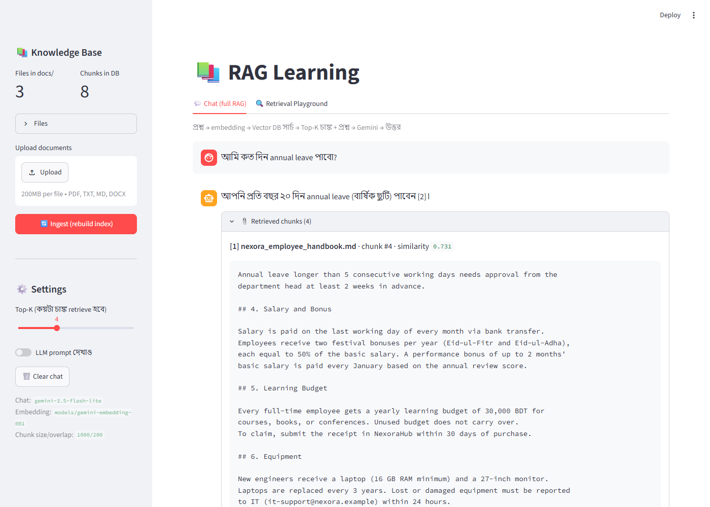
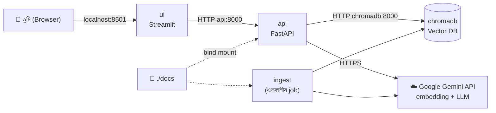

# 📚 RAG Learning — Docker দিয়ে পুরো একটা RAG সিস্টেম

নিজের ডকুমেন্ট (PDF, TXT, MD, DOCX) দাও, তারপর সেগুলো নিয়ে প্রশ্ন করো — AI উত্তর দেবে, আর সাথে দেখাবে
**কোন ফাইলের কোন অংশ থেকে** উত্তরটা এসেছে।

পুরো সিস্টেম Docker এ চলে: তোমার কম্পিউটারে Python, ChromaDB বা অন্য কিছু install করতে হবে না।



**এই প্রজেক্ট থেকে যা শিখবে:**

- RAG এর দুইটা পাইপলাইন (Ingestion আর Retrieval) কোডে কীভাবে লেখা হয়
- Chunking, Embedding, Vector DB, Similarity Search আসলে কী
- LLM কে কীভাবে prompt দিতে হয় যাতে সে বানিয়ে না বলে
- FastAPI দিয়ে backend আর Streamlit দিয়ে UI
- Docker Compose দিয়ে একাধিক service একসাথে চালানো

---

## সূচিপত্র

1. [RAG কী, এক মিনিটে](#১-rag-কী-এক-মিনিটে)
2. [সিস্টেমের আর্কিটেকচার](#২-সিস্টেমের-আর্কিটেকচার)
3. [ফোল্ডার স্ট্রাকচার](#৩-ফোল্ডার-স্ট্রাকচার)
4. [চালানো শুরু (Quick Start)](#৪-চালানো-শুরু-quick-start)
5. [কোড কীভাবে কাজ করে — ধাপে ধাপে](#৫-কোড-কীভাবে-কাজ-করে--ধাপে-ধাপে)
6. [API নিজে চালিয়ে দেখো](#৬-api-নিজে-চালিয়ে-দেখো)
7. [এই প্রজেক্টে Docker এর যা যা আছে](#৭-এই-প্রজেক্টে-docker-এর-যা-যা-আছে)
8. [এক্সপেরিমেন্ট করে শেখো](#৮-এক্সপেরিমেন্ট-করে-শেখো)
9. [Configuration](#৯-configuration)
10. [দরকারি Docker কমান্ড](#১০-দরকারি-docker-কমান্ড)
11. [সমস্যা ও সমাধান](#১১-সমস্যা-ও-সমাধান)
12. [পরের ধাপ](#১২-পরের-ধাপ)

---

## ১. RAG কী, এক মিনিটে

**সমস্যা:** LLM (যেমন Gemini) তোমার কোম্পানির ভেতরের ডকুমেন্ট পড়েনি, তাই সেগুলো নিয়ে প্রশ্ন করলে উত্তর জানে না —
বা আরো খারাপ, বানিয়ে বলে। আবার সব ডকুমেন্ট একসাথে prompt এ দিয়ে দেওয়াও যায় না, কারণ LLM এর একটা
**context window** আছে (একবারে কতটুকু টেক্সট পড়তে পারে তার সীমা), আর বেশি টেক্সট মানে বেশি খরচ ও ধীর।

**সমাধান — RAG (Retrieval Augmented Generation):** প্রশ্ন আসলে আগে ডকুমেন্টগুলো থেকে শুধু **প্রাসঙ্গিক
কয়েকটা টুকরো খুঁজে বের করো (Retrieval)**, তারপর সেই টুকরোগুলো প্রশ্নের সাথে LLM কে দাও (**Augmented**),
LLM সেগুলো পড়ে উত্তর লিখবে (**Generation**)।


RAG এ দুইটা আলাদা পাইপলাইন থাকে:

| পাইপলাইন | কখন চলে | কী হয় |
| --- | --- | --- |
| **১. Ingestion** (knowledge-base বানানো) | একবার (বা ডকুমেন্ট বদলালে) | ডকুমেন্ট → ছোট চাঙ্ক → প্রতিটা চাঙ্কের embedding (সংখ্যার vector) → Vector DB তে সেভ |
| **২. Retrieval** (প্রশ্নের উত্তর) | প্রতিটা প্রশ্নে | প্রশ্ন → embedding → Vector DB তে সবচেয়ে কাছের চাঙ্ক খোঁজা → চাঙ্ক + প্রশ্ন LLM কে → উত্তর |

**Embedding কী?** একটা টেক্সটকে অনেকগুলো সংখ্যার লিস্টে (vector) রূপান্তর করা, এমনভাবে যে **একই অর্থের টেক্সটের
vector কাছাকাছি হয়।** তাই "work from home" আর "remote work" এর vector কাছাকাছি, যদিও শব্দ আলাদা।
এমনকি বাংলায় "বাসা থেকে কাজ" লিখলেও ইংরেজি ডকুমেন্টের ঐ অংশটা খুঁজে পাওয়া যায়।
এই প্রজেক্টের embedding মডেল (`gemini-embedding-001`) প্রতিটা টেক্সটের জন্য **3072টা সংখ্যা** দেয়।

---

## ২. সিস্টেমের আর্কিটেকচার



| Container | কী করে | কোড | হোস্ট থেকে খুলতে |
| --- | --- | --- | --- |
| `chromadb` | Vector DB — চাঙ্কের টেক্সট, vector আর metadata রাখে, similarity search করে | অফিশিয়াল image `chromadb/chroma` | http://localhost:8001/api/v2/heartbeat |
| `api` | পুরো RAG লজিক: ingestion, retrieval, LLM কল | [backend/app/](backend/app/) | http://localhost:8000/docs |
| `ui` | চ্যাট UI — শুধু `api` কে কল করে, নিজে কোনো RAG লজিক জানে না | [frontend/streamlit_app.py](frontend/streamlit_app.py) | http://localhost:8501 |
| `ingest` | `api` এর **একই image**, শুধু command আলাদা — ingestion চালিয়ে বন্ধ হয়ে যায় | [backend/app/ingest.py](backend/app/ingest.py) | `docker compose run --rm ingest` |

> **কেন এভাবে আলাদা আলাদা container?** বাস্তবের প্রোডাকশন সিস্টেম এভাবেই বানানো হয়: Vector DB আলাদা
> সার্ভার, backend আলাদা, UI আলাদা। একটা বদলালে (যেমন Streamlit ফেলে React) বাকিগুলো ছুঁতে হয় না।

শুধু Gemini (embedding + LLM) Google এর ক্লাউডে চলে; বাকি সব তোমার মেশিনের Docker এ।

---

## ৩. ফোল্ডার স্ট্রাকচার

```
RAG-Learning/
├── docker-compose.yml        ← সব service এর সংজ্ঞা (শুরু করো এখান থেকে)
├── .env.example              ← কপি করে .env বানাও, API key বসাও
├── docs/                     ← তোমার নিজের ডকুমেন্ট এখানে (git এ যায় না)
├── sample_docs/              ← টেস্ট করার জন্য কাল্পনিক কোম্পানির ডকুমেন্ট
│
├── backend/                  ← "api" আর "ingest" container
│   ├── Dockerfile
│   ├── requirements.txt
│   └── app/
│       ├── config.py         ← সব সেটিং (env variable থেকে)
│       ├── vectorstore.py    ← ChromaDB + embedding মডেলের কানেকশন
│       ├── ingest.py         ← ১. Ingestion pipeline  (load → chunk → embed → store)
│       ├── rag.py            ← ২. Retrieval pipeline  (retrieve → context → LLM)
│       ├── main.py           ← FastAPI endpoints
│       └── inspect_db.py     ← Vector DB এর ভেতরে উঁকি দেওয়ার টুল
│
├── frontend/                 ← "ui" container
│   ├── Dockerfile
│   ├── requirements.txt
│   └── streamlit_app.py
│
├── RAGs/                     ← কোর্সের স্লাইড
├── assets/                   ← README এর স্ক্রিনশট
├── Ingestion_Pipeline.py     ← পুরনো লোকাল স্ক্রিপ্ট (নিচে নোট দেখো)
├── test_rag.py               ← পুরনো লোকাল স্ক্রিপ্ট
└── requirements.txt          ← পুরনো লোকাল স্ক্রিপ্টের প্যাকেজ (Docker এটা ব্যবহার করে না)
```

**কোড পড়ার সাজেস্টেড ক্রম:** `docker-compose.yml` → `config.py` → `ingest.py` → `vectorstore.py` → `rag.py` →
`main.py` → `streamlit_app.py`

---

## ৪. চালানো শুরু (Quick Start)

### যা লাগবে

- [Docker Desktop](https://www.docker.com/products/docker-desktop/) (চালু অবস্থায় থাকতে হবে)
- Google Gemini API key — ফ্রি তে পাবে এখানে: https://aistudio.google.com/apikey

### ধাপ ১: API key সেট করো

```powershell
Copy-Item .env.example .env      # PowerShell
# cp .env.example .env           # Git Bash / Linux / Mac
```

তারপর `.env` ফাইল খুলে `GOOGLE_API_KEY=` এর পরে নিজের key বসাও।
`.env` ফাইল `.gitignore` এ আছে, তাই ভুল করে GitHub এ চলে যাবে না।

### ধাপ ২: ডকুমেন্ট রাখো

নিজের PDF/TXT/MD/DOCX ফাইল `docs/` ফোল্ডারে রাখো। প্রথমবার টেস্ট করার জন্য sample ডকুমেন্টগুলো কপি করতে পারো:

```powershell
Copy-Item sample_docs\* docs\    # PowerShell
# cp sample_docs/* docs/         # Git Bash / Linux / Mac
```

(UI থেকেও ফাইল আপলোড করা যায় — ধাপ ৪ দেখো।)

### ধাপ ৩: সব চালু করো

```bash
docker compose up --build -d
```

- `--build` = Dockerfile থেকে image বানাও (প্রথমবার কয়েক মিনিট লাগবে, পরে cache থেকে দ্রুত হবে)
- `-d` = background এ চালাও (detached)

সব ঠিকমতো চলছে কিনা দেখো:

```bash
docker compose ps
```

তিনটা container (`chromadb`, `api`, `ui`) **Up** দেখাবে, আর `api` / `chromadb` এর পাশে **(healthy)**।

### ধাপ ৪: Ingest করো (knowledge-base বানাও)

দুইভাবে করা যায় — যেকোনো একটা:

**(ক) UI থেকে:** http://localhost:8501 খোলো → বাম পাশের sidebar এ **🔄 Ingest (rebuild index)** চাপো।
নতুন ফাইল আপলোড করতে চাইলে sidebar এর **Upload documents** দিয়ে আপলোড করে তারপর Ingest চাপো।

**(খ) কমান্ড লাইন থেকে:**

```bash
docker compose run --rm ingest
```

আউটপুট এরকম দেখাবে:

```
--- Ingestion শুরু: /app/docs ---
  [loaded] nexora_cloudbox_faq.txt (1 page/document)
  [loaded] nexora_employee_handbook.md (1 page/document)
  [loaded] office_rules_bn.txt (1 page/document)
  মোট page/document: 3, মোট chunk: 8
  [embedded] 8/8 chunks
--- Ingestion শেষ: 3 ফাইল, 8 chunk ---
```

### ধাপ ৫: প্রশ্ন করো 🎉

http://localhost:8501 এ গিয়ে প্রশ্ন করো। Sample ডকুমেন্টের জন্য কিছু প্রশ্ন:

| প্রশ্ন | কী শেখায় |
| --- | --- |
| How many days can I work from home? | সাধারণ RAG |
| আমি কত দিন annual leave পাবো? | বাংলা প্রশ্ন, ইংরেজি ডকুমেন্ট থেকে উত্তর (cross-lingual) |
| What is the fine for losing my ID card? | ইংরেজি প্রশ্ন, বাংলা ডকুমেন্ট থেকে উত্তর |
| What is the maximum file size on the Free plan? | অন্য ডকুমেন্ট (FAQ) থেকে retrieval |
| Who is the CEO of Nexora Tech? | ডকুমেন্টে নেই → "জানি না" বলা উচিত, বানিয়ে না বলা |

প্রতিটা উত্তরের নিচে **📎 Retrieved chunks** খুললে দেখবে কোন চাঙ্কগুলো LLM কে দেওয়া হয়েছিল আর তাদের
similarity score কত। Sidebar এ **LLM prompt দেখাও** চালু করলে LLM আসলে যে prompt পেয়েছে সেটাও দেখবে।

### বন্ধ করা

```bash
docker compose down        # container বন্ধ, কিন্তু Vector DB এর ডাটা থেকে যাবে
docker compose down -v     # ডাটা সহ সব মুছে ফেলো (-v = volume ও মুছবে)
```

---

## ৫. কোড কীভাবে কাজ করে — ধাপে ধাপে

### ১. Ingestion Pipeline — [backend/app/ingest.py](backend/app/ingest.py)

```
docs/ ফোল্ডার ──load_documents()──> Documents ──split_documents()──> Chunks ──store_chunks()──> ChromaDB
                                                                          (Gemini embedding API)
```

| ধাপ | ফাংশন | কী হয় |
| --- | --- | --- |
| Load | `load_file()`, `load_documents()` | প্রতিটা ফাইল থেকে টেক্সট বের করে `Document` বানায়। `Document` = টেক্সট (`page_content`) + তথ্য (`metadata`: কোন ফাইল, কোন পেজ)। PDF এর প্রতিটা পেজ আলাদা Document। |
| Chunk | `split_documents()` | `RecursiveCharacterTextSplitter` দিয়ে ~1000 ক্যারেক্টারের টুকরো বানায়, পাশাপাশি দুই টুকরোর মধ্যে 200 ক্যারেক্টার overlap রাখে। |
| Embed + Store | `store_chunks()` | পুরনো collection মুছে নতুন বানায়, তারপর ব্যাচে ব্যাচে চাঙ্কগুলো `vectorstore.add_documents()` এ পাঠায় — এটা Gemini থেকে vector এনে টেক্সট + vector + metadata ChromaDB তে সেভ করে। |

**কেন chunking?**
- পুরো একটা বড় PDF এর একটাই vector হলে সেটা অনেক বিষয়ের "গড়" হয়ে যায় — নির্দিষ্ট প্রশ্নের সাথে ভালো মেলে না।
- ছোট টুকরো হলে শুধু প্রাসঙ্গিক অংশটুকু LLM কে দেওয়া যায় — কম token, কম খরচ, কম বিভ্রান্তি।

**কেন overlap?** কোনো গুরুত্বপূর্ণ বাক্য ঠিক দুই চাঙ্কের সীমানায় কেটে গেলেও যেন অন্তত একটা চাঙ্কে পুরোটা থাকে।

**কেন `RecursiveCharacterTextSplitter`?** এটা আগে প্যারাগ্রাফ (`\n\n`) দিয়ে ভাঙার চেষ্টা করে, না পারলে লাইন (`\n`),
তারপর শব্দ (` `) — তাই যতটা সম্ভব অর্থপূর্ণ জায়গায় কাটে।

**কেন প্রতিবার collection মুছে নতুন করে বানাই?** কোনো ফাইল মুছে দিলে বা বদলালে তার পুরনো চাঙ্ক যেন DB তে থেকে না যায়।
শেখার জন্য এটাই সবচেয়ে সহজ ও নির্ভুল পদ্ধতি (বড় সিস্টেমে শুধু বদলানো ফাইলগুলো আপডেট করা হয়)।

### ২. Retrieval Pipeline — [backend/app/rag.py](backend/app/rag.py)

```
প্রশ্ন ──retrieve()──> Top-K চাঙ্ক ──build_context()──> context টেক্সট ──generate()──> উত্তর
       (embed + search)                (নম্বর দিয়ে সাজানো)        (prompt + Gemini)
```

| ধাপ | ফাংশন | কী হয় |
| --- | --- | --- |
| Retrieve | `retrieve()` | `similarity_search_with_score()` প্রশ্নটাকে **একই embedding মডেল** দিয়ে vector বানায়, তারপর ChromaDB তে সবচেয়ে কাছের `k` টা চাঙ্ক খোঁজে। ChromaDB **cosine distance** দেয় (ছোট = বেশি মিল); আমরা সেটাকে `similarity = 1 - distance` বানাই যাতে "বড় = বেশি মিল" হয়। |
| Context | `build_context()` | চাঙ্কগুলোকে `[1] (ফাইলের নাম, পেজ) টেক্সট...` আকারে সাজায়, যাতে LLM `[1]`, `[2]` দিয়ে source উল্লেখ করতে পারে। |
| Generate | `generate()` | Prompt বানিয়ে Gemini কে পাঠায়। |
| সব একসাথে | `answer()` | উপরের তিনটা ধাপ চালিয়ে উত্তর + source চাঙ্ক + আসল prompt ফেরত দেয়। |

LangChain এর তৈরি "chain" (`create_retrieval_chain` ইত্যাদি) ইচ্ছে করেই ব্যবহার করা হয়নি — প্রতিটা ধাপ
সাধারণ Python ফাংশনে লেখা, যাতে কোথায় কী হচ্ছে স্পষ্ট দেখা যায়।

**Prompt এর গঠন** (`PROMPT` ভ্যারিয়েবল):

```
System: You are a helpful assistant that answers questions using ONLY the provided context.
- Reply in the same language as the question ...
- Cite the sources you used like [1], [2] ...
- If the context does not contain the answer, just say that you don't know ...
Human: Context:
[1] (nexora_cloudbox_faq.txt)
...চাঙ্কের টেক্সট...

---

[2] (...)
...

Question: What happens to deleted files on the Business plan?
```

- **System message** = নিয়মকানুন (সব প্রশ্নে একই)।
- **Human message** = এই প্রশ্নের context + প্রশ্ন।
- "ONLY the provided context" আর "say you don't know" — এই দুইটা লাইনই **hallucination** (বানিয়ে বলা) কমানোর মূল চাবি।

### ৩. সবচেয়ে গুরুত্বপূর্ণ নিয়ম: একই Embedding মডেল

[backend/app/vectorstore.py](backend/app/vectorstore.py) এর `get_embeddings()` ingestion আর retrieval **দুই জায়গাতেই**
ব্যবহার হয়। ডকুমেন্ট এক মডেল দিয়ে আর প্রশ্ন অন্য মডেল দিয়ে embed করলে দুটো vector একই "ভাষায়" থাকে না —
search অর্থহীন রেজাল্ট দেবে, বা dimension না মিললে সরাসরি error দেবে। তাই `EMBEDDING_MODEL` বদলালে **অবশ্যই আবার ingest করতে হবে।**

### ৪. API — [backend/app/main.py](backend/app/main.py)

| Method | Endpoint | কাজ |
| --- | --- | --- |
| GET | `/health` | API আর ChromaDB চলছে কিনা |
| GET | `/stats` | কয়টা চাঙ্ক আছে, কোন ফাইল আছে, কোন মডেল ব্যবহার হচ্ছে |
| GET | `/documents` | `docs/` ফোল্ডারের ফাইল লিস্ট |
| POST | `/upload` | ফাইল `docs/` এ সেভ (multipart form, field নাম `files`) |
| POST | `/ingest` | পুরো knowledge-base নতুন করে বানাও |
| POST | `/search` | **শুধু retrieval** — LLM ছাড়া, কোন চাঙ্ক আসছে দেখার জন্য |
| POST | `/ask` | **পুরো RAG** — উত্তর + source + prompt |

### ৫. UI — [frontend/streamlit_app.py](frontend/streamlit_app.py)

UI তে কোনো RAG লজিক নেই, শুধু `requests` দিয়ে API কল করে। দুইটা ট্যাব:

- **💬 Chat (full RAG)** — `/ask` কল করে
- **🔍 Retrieval Playground** — `/search` কল করে। LLM ছাড়া শুধু retriever কী আনছে দেখো। RAG এর উত্তর খারাপ হলে
  প্রথমে এখানে দেখো: সঠিক চাঙ্ক আসছে তো? না আসলে সমস্যা retrieval এ (chunking/embedding), LLM এ না।

---

## ৬. API নিজে চালিয়ে দেখো

সবচেয়ে সহজ: ব্রাউজারে **http://localhost:8000/docs** খোলো (Swagger UI)। যেকোনো endpoint এ ক্লিক → **Try it out** → **Execute**।

কমান্ড লাইন থেকে:

**PowerShell** (Windows এ `curl` আসলে অন্য কমান্ডের alias, তাই `Invoke-RestMethod` ব্যবহার করো):

```powershell
# Health
Invoke-RestMethod http://localhost:8000/health

# প্রশ্ন করো
$body = @{ question = "How much is the learning budget?"; k = 3 } | ConvertTo-Json
$r = Invoke-RestMethod -Method Post -Uri http://localhost:8000/ask -ContentType "application/json" -Body $body
$r.answer
$r.sources | Select-Object source, similarity

# শুধু retrieval
Invoke-RestMethod -Method Post -Uri http://localhost:8000/search -ContentType "application/json" -Body $body
```

**Git Bash / Linux / Mac:**

```bash
curl http://localhost:8000/health

curl -X POST http://localhost:8000/ask \
  -H "Content-Type: application/json" \
  -d '{"question": "How much is the learning budget?", "k": 3}'

curl -X POST http://localhost:8000/upload -F "files=@my_file.pdf"
curl -X POST http://localhost:8000/ingest
```

`/ask` এর রেসপন্স:

```json
{
  "question": "How much is the learning budget?",
  "answer": "Every full-time employee gets a yearly learning budget of 30,000 BDT [1].",
  "sources": [
    {
      "source": "nexora_employee_handbook.md",
      "page": null,
      "chunk_id": 4,
      "similarity": 0.6426,
      "content": "..."
    }
  ],
  "prompt": "System: You are a helpful assistant ..."
}
```

---

## ৭. এই প্রজেক্টে Docker এর যা যা আছে

[docker-compose.yml](docker-compose.yml) খুলে পাশাপাশি পড়ো:

| ধারণা | কোথায় | ব্যাখ্যা |
| --- | --- | --- |
| **Image vs Container** | — | Image = রেসিপি/টেমপ্লেট (Dockerfile থেকে বানানো), Container = সেই image থেকে চালু হওয়া একটা প্রসেস। একটা image থেকে অনেক container চালানো যায়। |
| **Dockerfile + layer cache** | [backend/Dockerfile](backend/Dockerfile) | আগে শুধু `requirements.txt` কপি করে `pip install`, তারপর কোড কপি। তাই কোড বদলালে প্যাকেজ আবার ডাউনলোড হয় না — cache থেকে আসে। |
| **Service নাম = hostname** | `CHROMA_HOST: chromadb`, `API_URL: http://api:8000` | Compose সব service কে একটা network এ রাখে; একে অপরকে service নাম দিয়ে ডাকে। `localhost` container এর ভেতরে মানে **ঐ container নিজেই**, তোমার পিসি না! |
| **Port mapping** | `"8001:8000"` | `হোস্ট_পোর্ট:container_পোর্ট`। ChromaDB container এর ভেতরে 8000 এ চলে, কিন্তু হোস্টে 8000 এ api আছে, তাই হোস্টে 8001 দিয়ে খোলা হয়েছে। Container গুলো নিজেদের মধ্যে কথা বলে ভেতরের পোর্ট (8000) দিয়েই। |
| **Named volume** | `chroma_data:/data` | Docker নিজে ম্যানেজ করে এমন স্টোরেজ। `docker compose down` দিলেও Vector DB এর ডাটা থাকে; `down -v` দিলে মুছে যায়। |
| **Bind mount** | `./docs:/app/docs` | তোমার পিসির ফোল্ডার সরাসরি container এর ভেতরে দেখা যায়। পিসিতে ফাইল রাখলে container সাথে সাথে দেখে; UI থেকে আপলোড করলে পিসির `docs/` এ চলে আসে। `ingest` এ `:ro` = read-only। |
| **env_file / environment** | `env_file: .env` | Secret (API key) কোডে না লিখে environment variable হিসেবে দেওয়া। |
| **healthcheck + depends_on** | `condition: service_healthy` | `api` শুরু হয় ChromaDB **healthy** হওয়ার পরে, `ui` শুরু হয় `api` healthy হওয়ার পরে। শুধু "চালু হয়েছে" না, "রেডি" হওয়া পর্যন্ত অপেক্ষা। |
| **একই image, ভিন্ন command** | `ingest` service | `api` আর `ingest` একই `rag-learning-backend` image ব্যবহার করে; `ingest` শুধু `python -m app.ingest` চালায়। |
| **profiles** | `profiles: ["tools"]` | `ingest` সাধারণ `docker compose up` এ চালু হয় না; শুধু `docker compose run ingest` দিলে চলে। |
| **restart policy** | `restart: unless-stopped` | Container crash করলে বা পিসি রিস্টার্ট হলে Docker নিজেই আবার চালু করবে। |
| **Watch mode** | `develop.watch` | `docker compose up --watch` দিলে কোড সেভ করা মাত্র container এ sync হয় — আবার build করতে হয় না (নিচে দেখো)। |

### কোড বদলাতে বদলাতে শেখা (Watch mode)

```bash
docker compose up --watch
```

এখন `backend/app/` এর কোনো ফাইল সেভ করলেই সেটা `api` container এ কপি হয়ে container রিস্টার্ট হবে, আর
`frontend/streamlit_app.py` সেভ করলে UI নিজে থেকে রিলোড হবে। `requirements.txt` বদলালে image আবার build হবে।
(`Ctrl+C` দিলে watch বন্ধ হবে।)

Watch ছাড়া চালালে কোড বদলানোর পর: `docker compose up --build -d`

---

## ৮. এক্সপেরিমেন্ট করে শেখো

এগুলো করে দেখো — RAG সত্যিকার অর্থে বুঝবে:

1. **Vector দেখো নিজের চোখে**
   ```bash
   docker compose exec api python -m app.inspect_db
   ```
   প্রতিটা চাঙ্কের id, metadata, টেক্সট আর 3072 সংখ্যার vector এর শুরুটা দেখাবে।

2. **Similarity নিজে হাতে হিসাব করো**
   ```bash
   docker compose exec api python -m app.inspect_db "How many days can I work from home?"
   ```
   এটা numpy দিয়ে cosine similarity `(a·b) / (|a|·|b|)` হিসাব করে। UI এর Retrieval Playground এ একই প্রশ্ন দিয়ে দেখো —
   সংখ্যাগুলো হুবহু মিলবে। অর্থাৎ retriever কোনো জাদু না, শুধু এই অংক!

3. **Chunk size বদলাও** — `.env` এ `CHUNK_SIZE=300` আর `CHUNK_OVERLAP=50` দাও, তারপর:
   ```bash
   docker compose up -d          # নতুন env নিয়ে api রিস্টার্ট
   docker compose run --rm ingest
   ```
   চাঙ্ক সংখ্যা কত হলো? Retrieval Playground এ একই প্রশ্নের রেজাল্ট কীভাবে বদলালো? খুব ছোট চাঙ্কে context হারায়,
   খুব বড় চাঙ্কে অপ্রাসঙ্গিক টেক্সট ঢোকে — এটাই chunking এর trade-off।

4. **Top-K বদলাও** — sidebar এর slider দিয়ে K=1 আর K=8 এ একই প্রশ্ন করো। K কম হলে দরকারি তথ্য বাদ পড়তে পারে, বেশি হলে অপ্রাসঙ্গিক তথ্য ঢোকে।

5. **Hallucination টেস্ট** — ডকুমেন্টে নেই এমন প্রশ্ন করো ("Who is the CEO?")। তারপর [rag.py](backend/app/rag.py) এর prompt থেকে
   "If the context does not contain the answer..." লাইনটা মুছে দিয়ে আবার করো। পার্থক্য দেখো।

6. **ছোট vs বড় মডেল** — ডিফল্ট মডেল `gemini-3.5-flash-lite` (দ্রুত, কম খরচ)। "Who is the CEO of Nexora Tech?" (ইংরেজিতে)
   জিজ্ঞেস করো — lite মডেল মাঝে মাঝে বাংলায় উত্তর দিয়ে ফেলে, কারণ context এ বাংলা ডকুমেন্ট আছে। এবার `.env` এ
   `CHAT_MODEL=gemini-3.8-flash` দিয়ে `docker compose up -d` চালাও, আবার জিজ্ঞেস করো। বড় মডেল নির্দেশনা বেশি
   ভালোভাবে মানে — কিন্তু ধীর আর বেশি খরচের। (Embedding মডেল একই থাকছে, তাই re-ingest লাগবে না।)

7. **Cross-lingual search** — বাংলায় প্রশ্ন করো যার উত্তর ইংরেজি ডকুমেন্টে আছে, আর উল্টোটা। Embedding মডেল
   ভাষা না, **অর্থ** ধরে — তাই কাজ করে।

8. **Prompt দেখো** — sidebar এ "LLM prompt দেখাও" চালু করো। LLM আসলে কী পাচ্ছে সেটা বোঝা RAG debugging এর সবচেয়ে বড় হাতিয়ার।

---

## ৯. Configuration

সব সেটিং `.env` ফাইলে environment variable হিসেবে দেওয়া যায় ([.env.example](.env.example) দেখো)। বদলানোর পর `docker compose up -d` দিলে
api নতুন সেটিং নিয়ে রিস্টার্ট হবে।

| Variable | ডিফল্ট | কী করে | বদলালে re-ingest লাগবে? |
| --- | --- | --- | --- |
| `GOOGLE_API_KEY` | — (অবশ্যই দিতে হবে) | Gemini API key | না |
| `CHAT_MODEL` | `gemini-3.5-flash-lite` | উত্তর লেখার LLM | না |
| `EMBEDDING_MODEL` | `models/gemini-embedding-001` | টেক্সট → vector মডেল | **হ্যাঁ** |
| `CHUNK_SIZE` | `1000` | প্রতিটা চাঙ্কের সর্বোচ্চ ক্যারেক্টার | **হ্যাঁ** |
| `CHUNK_OVERLAP` | `200` | পাশাপাশি চাঙ্কের মধ্যে কমন ক্যারেক্টার | **হ্যাঁ** |
| `TOP_K` | `4` | API তে ডিফল্ট কয়টা চাঙ্ক retrieve হবে (UI slider এটা override করে) | না |
| `EMBED_BATCH_SIZE` | `50` | একবারে কয়টা চাঙ্ক embedding API তে যাবে | না |
| `COLLECTION_NAME` | `rag_docs` | ChromaDB collection এর নাম | — |
| `DOCS_PATH` | `./docs` | হোস্টের কোন ফোল্ডার container এ `/app/docs` হিসেবে যাবে | — |

উদাহরণ: `docs/` তে কিছু না রেখে সরাসরি sample ডকুমেন্ট দিয়ে চালাতে চাইলে `.env` এ `DOCS_PATH=./sample_docs` দাও।

তোমার API key দিয়ে কোন কোন মডেল ব্যবহার করা যাবে দেখতে:

```bash
docker compose exec api python -c "from google import genai; c = genai.Client(); [print(m.name) for m in c.models.list()]"
```

---

## ১০. দরকারি Docker কমান্ড

| কমান্ড | কাজ |
| --- | --- |
| `docker compose up --build -d` | সব build করে background এ চালাও |
| `docker compose ps` | কোন container চলছে, healthy কিনা |
| `docker compose logs -f api` | api এর লাইভ লগ দেখো (`Ctrl+C` দিয়ে বের হও) |
| `docker compose logs --tail 50 ui` | ui এর শেষ ৫০ লাইন লগ |
| `docker compose run --rm ingest` | ingestion চালাও (`--rm` = শেষে container মুছে দাও) |
| `docker compose exec api bash` | চলমান api container এর ভেতরে shell খোলো (`exit` দিয়ে বের হও) |
| `docker compose restart api` | শুধু api রিস্টার্ট |
| `docker compose up --watch` | কোড বদলালে অটো sync (development) |
| `docker compose down` | সব বন্ধ (ডাটা থাকবে) |
| `docker compose down -v` | সব বন্ধ + Vector DB এর ডাটা মুছে ফেলো |
| `docker volume ls` | সব volume দেখো (`rag-learning_chroma_data` থাকবে) |

---

## ১১. সমস্যা ও সমাধান

**`docker compose up` এ error: "failed to connect to the docker API"**
→ Docker Desktop চালু নেই। চালু করো, নিচে বাম কোণায় "Engine running" দেখা পর্যন্ত অপেক্ষা করো।

**UI তে "API তে কানেক্ট করা যাচ্ছে না"**
→ `docker compose ps` দেখো `api` healthy কিনা। না হলে `docker compose logs api` দেখো — সাধারণত Python error বা `.env` সমস্যা।

**`API key not valid` / `PERMISSION_DENIED`**
→ `.env` এ `GOOGLE_API_KEY` ঠিক আছে কিনা দেখো (কোটেশন বা স্পেস ছাড়া)। `.env` বদলানোর পর `docker compose up -d` দিতে হবে।

**`429 RESOURCE_EXHAUSTED` (rate limit)**
→ Free tier এ প্রতি মিনিটে রিকোয়েস্টের সীমা আছে। Ingestion নিজে থেকেই অপেক্ষা করে আবার চেষ্টা করে; বেশি হলে `.env` এ
`EMBED_BATCH_SIZE=20` দাও। প্রশ্ন করার সময় হলে একটু পরে আবার চেষ্টা করো।

**`404 NOT_FOUND ... model is no longer available`**
→ Google পুরনো মডেল বন্ধ করে দেয়। [Configuration](#৯-configuration) সেকশনের কমান্ড দিয়ে available মডেল দেখে `.env` এ `CHAT_MODEL` বদলাও।

**`503 UNAVAILABLE ... high demand`**
→ Google এর সার্ভারে চাপ। কিছুক্ষণ পরে চেষ্টা করো, বা অন্য মডেল (`CHAT_MODEL`) দাও।

**Ingest এ "কোনো টেক্সট পাওয়া যায়নি" বা PDF এর চাঙ্ক 0**
→ PDF টা সম্ভবত স্ক্যান করা ছবি — ভেতরে টেক্সট নেই। এর জন্য OCR লাগবে (এই প্রজেক্টে নেই)।

**`port is already allocated`**
→ 8000, 8001 বা 8501 পোর্টে অন্য কিছু চলছে। `docker-compose.yml` এ বাম পাশের (হোস্ট) পোর্ট বদলাও, যেমন `"8502:8501"`।

**Embedding মডেল বদলানোর পর search এ error বা আজব রেজাল্ট**
→ পুরনো vector গুলো আগের মডেলের। আবার ingest করো: `docker compose run --rm ingest`

**কোড বদলালাম কিন্তু কিছু বদলায়নি**
→ Image আবার build করতে হবে: `docker compose up --build -d` (বা `--watch` মোডে চালাও)।

---

## ১২. পরের ধাপ

এই সিস্টেম বুঝে গেলে এগুলো যোগ করে দেখতে পারো (সহজ থেকে কঠিন):

- **Streaming উত্তর** — উত্তর একবারে না এসে ChatGPT এর মতো লেখা হতে হতে আসবে (`llm.stream()`)
- **Chat history** — আগের প্রশ্নের প্রসঙ্গ মনে রাখা ("আর sick leave?" এর মতো follow-up প্রশ্ন)
- **Metadata filter** — নির্দিষ্ট ফাইলের মধ্যেই সার্চ করা (`similarity_search(..., filter={"source": "x.pdf"})`)
- **Hybrid search** — vector search এর সাথে keyword search (BM25) মেলানো; নাম, কোড, নম্বর খুঁজতে ভালো
- **Re-ranking** — বেশি চাঙ্ক (যেমন 20) এনে আরেকটা মডেল দিয়ে সেরা 4টা বাছাই
- **Incremental ingestion** — পুরো DB না মুছে শুধু নতুন/বদলানো ফাইল আপডেট (ফাইলের hash দিয়ে)
- **Evaluation** — প্রশ্ন-উত্তরের একটা সেট বানিয়ে মাপা যে retrieval আর উত্তর কতটা ঠিক (যেমন RAGAS)
- **পুরো লোকাল** — Gemini এর বদলে [Ollama](https://ollama.com) container দিয়ে লোকাল LLM আর embedding চালানো

---

## পুরনো স্ক্রিপ্ট সম্পর্কে নোট

`Ingestion_Pipeline.py` আর `test_rag.py` হলো এই প্রজেক্টের আগের, venv দিয়ে চালানো লোকাল ভার্সন। Docker ভার্সন
এগুলোর জায়গা নিয়েছে, তবে শেখার জন্য রেখে দেওয়া হয়েছে। এগুলোতে দুইটা শিক্ষণীয় সমস্যা আছে:

1. **Embedding মডেল মেলে না:** ingestion এ `text-embedding-004` কিন্তু query তে `embedding-001` — ঠিক
   [এই নিয়মটা](#৩-সবচেয়ে-গুরুত্বপূর্ণ-নিয়ম-একই-embedding-মডেল) ভাঙা হয়েছে। Docker ভার্সনে দুই জায়গাই একই
   `get_embeddings()` ফাংশন ব্যবহার করে, তাই এই ভুল হওয়া সম্ভব না।
2. **মডেলগুলো আর নেই:** `text-embedding-004`, `embedding-001` আর `gemini-1.5-flash` Google বন্ধ করে দিয়েছে।
   এছাড়া `langchain.chains` LangChain 1.0 থেকে মূল প্যাকেজে নেই।
